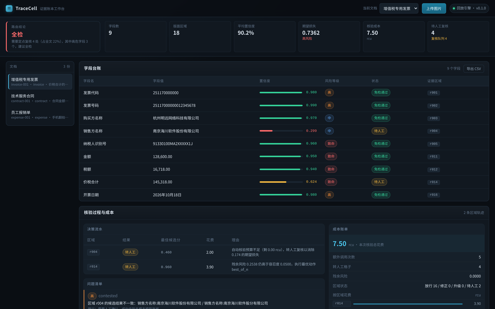
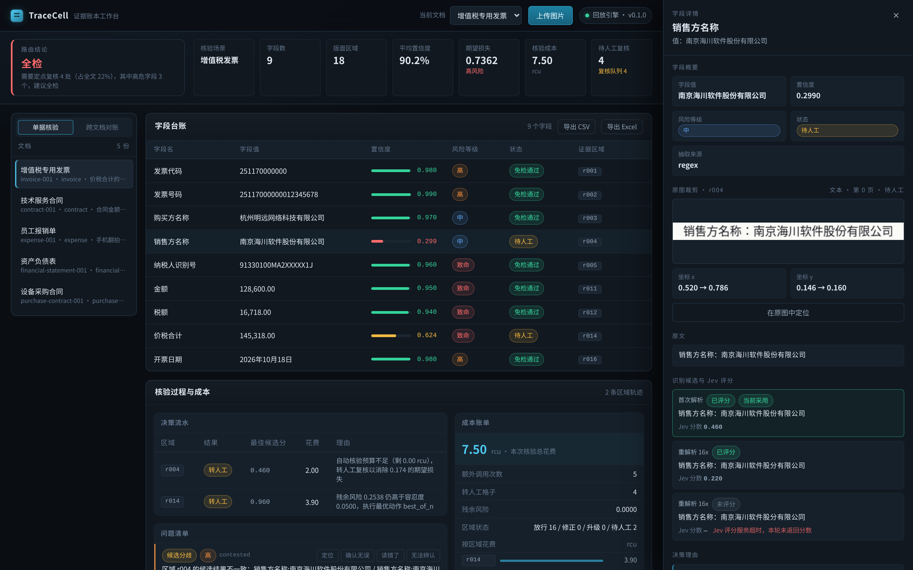
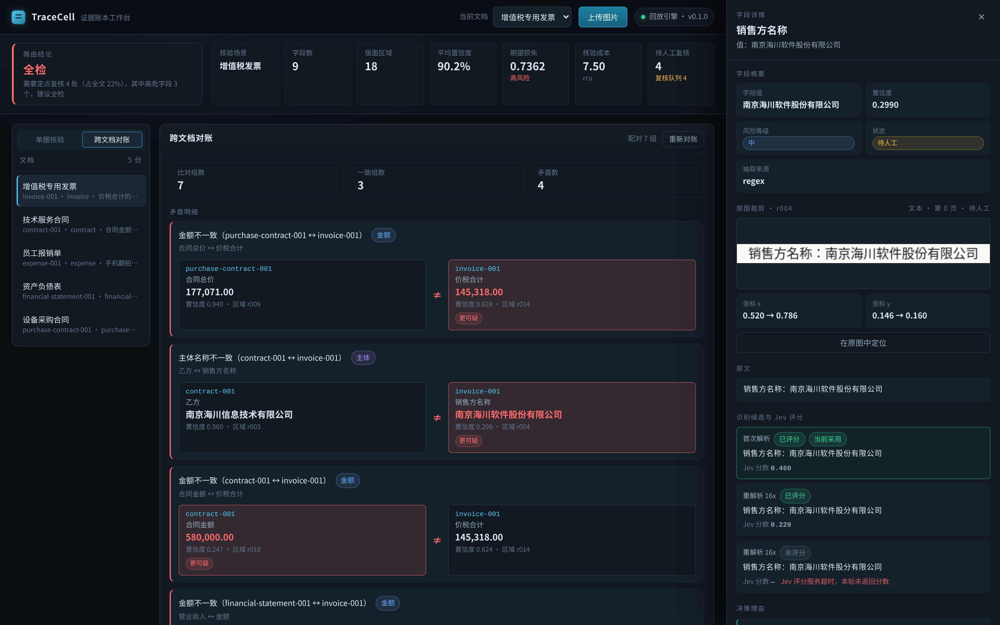

# TraceCell · 溯格

> 别人给你一段 OCR 结果，TraceCell 给你一份能签字的结论。

`Apache-2.0` · `Python 3.10+` · `MCP` · `MiniCPM-OCR 1.0` / `MiniCPM-OCR Jev` / `MiniCPM-V 4.7`

仓库：[GitHub](https://github.com/logicore-code/TraceCell) · [GitCode](https://gitcode.com/gcw_EkTYFH3T/TraceCell)（两端同步，提交历史一致）



## 要解决的问题

做文档识别的模型这两年进步很快，MiniCPM-OCR 1.0 在真实场景的解析成绩已经是
SOTA。但企业端真正头疼的问题变了。

现在不是"认不认得出"，是"错在哪、谁负责"。一张发票的金额被认错一位，如果
系统不标出来，它会一路流进账本、流进报表、流进对账，直到半年后有人发现。
财务系统里最贵的从来不是那次识别错误，是那次没人发现的识别错误。

OpenBMB 十月底放出来的 MiniCPM-OCR Jev 正好补上了中间这块：给每个区域一个
0~1 的正确性分数。但从"这一段读得对不对"到"这份文档能不能拿去签字"，中间
还空着一层决策——分数怎么变成"免检还是转人工"，低分区域谁来修，修得好不好
谁管，阈值按什么定，几份单据之间对不上时谁来发现。

TraceCell 补的就是这一层。

## 一个引擎，五个场景

发票核验、财务报表核验、购销合同金额核验，需求看着不一样，拆开看是同一套：
把纸面上的字段读出来 → 判断每个字段有多可信 → 发现自相矛盾的地方 → 决定
哪些要人看。

所以引擎只有一套，场景差异全部收在一份配置里：

| 场景 | 声明字段 | 单据内部查什么 | 跟哪些单据对 |
| --- | --- | --- | --- |
| 增值税发票 | 9 | 价税合计 = 金额 + 税额 | 购销合同、服务合同、报表 |
| 技术服务合同 | 8 | 大写金额 = 小写金额 | 发票（甲方 / 乙方 / 合同金额） |
| 员工报销单 | 6 | 明细之和 = 合计 | — |
| 资产负债表 | 10 | 资产 = 流动 + 非流动；资产 = 负债 + 权益 | 发票（营业收入） |
| 设备采购合同 | 13 | 逐行 金额 = 数量 × 单价；合计 = 各行之和；总价 = 合计 + 税额；大写 = 小写 | 发票（总价 / 需方 / 供方） |

「声明字段」是场景配置里写死的；明细行是运行时按表格抽的，所以实际台账里的
字段数会更多——报销单多出 3 条明细，购销合同多出 9 条。

五个场景共用同一套解析、评分、预算决策和路由，差别只有四样东西：抽哪些
字段、哪些字段危险、内部有哪些勾稽关系、跟别的场景怎么对齐。

```bash
tracecell scenarios      # 看当前支持哪些场景
```

加一个新场景就是往 `src/tracecell/scenarios.py` 里加一段配置——字段正则、
风险等级、勾稽关系、跨文档配对——引擎一行不用动。上面那张表就是照着这个
文件写的。

### 跨场景配对

单份文档的勾稽关系好理解，难的是几份单据之间对不对得上，而且它们字段名
往往不一样：合同叫"合同总价"，发票叫"价税合计"；合同叫"乙方"，发票叫
"销售方名称"。靠字段名撞车是撞不出来的。

TraceCell 用一张显式的配对表来定义这些关系：

```python
CrossRule("purchase_contract", "合同总价", "invoice", "价税合计", "money"),
CrossRule("contract", "乙方", "invoice", "销售方名称", "entity"),
CrossRule("financial_statement", "营业收入", "invoice", "金额", "money"),
```

顺带修掉一个隐患：以前发票的"金额"和报销单的"金额"会被拿去互比，128,600
和 2,864.50 一比就是个假矛盾。现在同名字段只在同场景之间比对。

## 长什么样

输入一张单据，输出的是一张台账。每一行都能点开，看见它在原图上的那一格：



点开「销售方名称」，右边是这块区域的原图裁剪、归一化坐标、两次识别读出来的
候选和各自的 Jev 分数，以及 Agent 当时的判断理由。底部是核验流水：每格做了
什么动作、置信度怎么变的、花了多少算力，以及最后一份能直接当工单用的复核
清单。

左边可以切到「跨文档对账」，把五份样例放在一起比：



左右并排显示两边各自的取值、置信度和证据区域，置信度低的那一侧标成「更可疑」。
点文档名能跳回单据核验视图并高亮对应的那一行。

问题清单里每条都能直接做人工复核——确认无误、读错了、无法辨认。标完回灌
账本，被确认的区域直接放行，同时这条标注变成标定样本。

## 快速跑起来

不需要 GPU，样例数据已经录好：

```bash
git clone https://github.com/logicore-code/TraceCell.git
cd TraceCell
pip install -e ".[web]"

tracecell demo      # 命令行跑完整链路，五份样例全跑一遍
tracecell serve     # 浏览器打开 http://127.0.0.1:8000
```

回放模式跑的是同一套策略代码，把三个模型的调用换成了录制数据。接上真实模型
改一个参数就行：

```bash
tracecell serve --provider minicpm
```

镜像源不稳或者离线环境装不上构建依赖，用 `pip install -e ".[web]" --no-build-isolation`，
本机的 setuptools 就够。

## 核心机制

### 证据账本

输出不是 Markdown，是一张带坐标、置信度、状态的表。

字段值靠"归一化子串匹配 + 字符 bigram 相似度"锚定回原文区域，锚定不上就标
"无证据支撑"。指错地方的证据比没有证据更危险——前者会让人基于错误的定位
去做复核。

### 置信度悲观继承

字段置信度取支撑它的所有区域里的最小值，不取平均值。

合同金额如果从两处拼出来，其中一处认错了，这个字段就是错的。取平均看着
"更准"，实际是让错误静悄悄过去，而这个项目存在的意义就是让错误显形。候选
之间读数不一致时，置信度再打 0.65 的折。

### 对抗式核验闭环

Jev 只能告诉你"这段大概率不对"，不能告诉你"这段到底写了什么"。修复得由
系统自己做：

```
   首次解析(4x)  →  Jev 0.31  →  换 16x 档重解析  →  Jev 择优 0.88  →  放行
                                              ↓
                                    还是不行 → MiniCPM-V 4.7 定向复核
                                              ↓
                                       还是不行 → 转人工（附裁剪图与全部候选）
```

对抗候选从哪来？同一块内容用 4x 和 16x 两档视觉 token 压缩各读一次，两次
读出来不一致本身就是"这一格有歧义"的信号。

升级复核问的是窄问题，比如"这块是 A 还是 B，只回答正确的那个"，不是"请
描述这块内容"。窄问题的答案短、能判定，可以直接变成新候选再交回 Jev 复评，
闭环才接得上；宽问题会得到一段散文，没法自动核验。

### 逐格预算决策

每个区域都被问同一个问题：现在的残余风险有多大，再查一次能换回多少，这次
推理要花多少，让人来看一眼又要花多少、换回多少。

```
Δ(a)   = weight × [(1 - c) - (1 - c'_a)]     风险下降
效率(a) = Δ(a) / cost(a)                     每单位成本的收益
```

取效率最高的动作，但有两道闸。预算按风险等级分配，致命字段拿走 45%，低危
字段只拿 5%。人工复核也放进对照：准确率按 0.995 算、成本 8 rcu，效率上人工
更划算时直接转人——低危格子上让人看是浪费，高危格子上让人看可能比再跑三次
模型更划算。

每一步的理由和花费都写进账本，可以事后审计。

### 风险加权路由

文档级给免检、抽检、全检三档。

抽检样本量不是拍脑袋定的。设单件出错概率 p，抽 m 件独立样本，至少发现一处
错误的概率是 1-(1-p)^m，要求不低于 1-δ：

```
m ≥ ln(δ) / ln(1 - p)
```

这个式子让"抽检"有统计依据，抽多少才算够是算出来的。

### 勾稽校验

单据内部对不上、几份单据之间对不上，是两类问题，都归到这一层。

明细加起来应该等于合计，数量乘单价应该等于金额。这类矛盾 OCR 质量模型解决
不了——分项和总数都识别正确，错的是单据本身：

```
差旅费     1,480.00
办公用品     386.50
业务招待费 1,098.00
          ─────────
明细合计   2,964.50    ← 三行明细加起来
单据合计  ¥2,864.50    ← 单据上印的      差额 +100.00
```

勾稽关系按场景显式声明而不是自动推断。发票的表格里既有明细行也有小计行，
凭正则猜哪些数是明细、哪些是科目会误报；声明式规则把判断交给懂业务的人，
代码只负责算。

支持五种关系：加总、乘法、大写对小写、逐行乘法、整单加总。逐行的意思是
把明细表按品名分组，一行一行地验：

```
边缘网关设备　20　1,180.00　26,600.00
                  ↑ 20 × 1,180.00 = 23,600.00，差 3,000
```

这一处 OCR 读得很准（0.83 分）——它确实就印在纸上。抓住它的是算术，不是模型。

## 真实模型跑出来的东西

仓库里有两份录制数据，都是真模型跑出来的，不是手写的：

- `samples/real_ocr/`——MiniCPM-OCR 1.0 的真实输出，llama.cpp 加 Q4_K_M 量化
  权重在纯 CPU 上跑的。复现命令见 `scripts/record_ocr.py`。
- `samples/jev_scores.json`——Jev 给每个候选读数的真实打分，同样是 llama.cpp
  跑官方 GGUF。复现命令见 `scripts/record_jev.py`。

样例会话里的 Jev 分数就是从这份录制数据读回去的，所以演示里看到的置信度、
阈值和 AUROC，背后是真的模型。

还有一组是对照：Jev 官方仓库里放了三组样例，每组给出原图块、参考渲染图，
以及官方自己跑出来的概率。文件收在 `references/jev_official/`（Apache-2.0），
`scripts/verify_against_official.py` 拿它们对照本机的打分结果：

```
$ python3 scripts/verify_against_official.py
```

官方样例 03 里有句话值得抄下来：表格的正确转写只拿到 0.04 分——**绝对分
不可用，要比的是候选之间的排序**。这条限制对所有区域都成立，所以
TraceCell 的阈值是标定出来的，不是一个拍脑袋的数。

跑出来三件事，恰好是这个项目存在的理由：

标题「浙江增值税专用发票」被读成了「江西」。用眼睛扫一遍容易漏。

合同正文出现了整段幻觉。甲方、乙方、签署日期都读对了，正文却换成了一段关于
"闲置募集资金"的内容，和原件毫无关系。这段错误通顺、规整、术语专业，是最难
发现的一类。

报销单的明细加起来 2,964.50，单据上印的合计是 ¥2,864.50，差 100 块。两边
OCR 都读对了，矛盾只存在于两份读数之间，识别得再准也发现不了，只能靠加总
校验。这条后来做成了代码能力，在报销单样例里被自动报成 critical 级问题。

## 数字

`tracecell demo` 的实际输出：

```
invoice-001              增值税专用发票   → full_review   待复核 4 格  13.10 rcu
contract-001             技术服务合同     → spot_check    待复核 2 格  12.60 rcu
expense-001              员工报销单       → spot_check    待复核 2 格  10.70 rcu
financial-statement-001  资产负债表       → full_review   待复核 5 格   8.60 rcu
purchase-contract-001    设备采购合同     → full_review   待复核 3 格   9.00 rcu
```

5 份样例共 83 个版面区域、52 个业务字段，42 条问题（其中 20 条是高危或
致命），16 格待人工，合计 54.00 rcu、额外推理调用 35 次。

内部勾稽抓到四处：报销单明细比合计少 100 元、资产负债表该平没平差 100,000、
购销合同的明细行金额多了 3,000（行内乘法与整单加总两条规则同时命中）、以及
一处大写小写不符。

跨文档对账（`tracecell reconcile`）：五份样例之间比对 7 组，一致 3 组，矛盾
4 处：

```
✗ 金额不一致（purchase-contract-001 ↔ invoice-001）：合同总价=146,318.00  vs  价税合计=145,318.00
✗ 主体名称不一致（contract-001 ↔ invoice-001）：乙方=南京海川信息技术有限公司  vs  销售方名称=南京海川软件股份有限公司
✗ 金额不一致（contract-001 ↔ invoice-001）：合同金额=580,000.00  vs  价税合计=145,318.00
✗ 金额不一致（financial-statement-001 ↔ invoice-001）：营业收入=128,000.00  vs  金额=128,600.00
```

第一条是购销合同的合同总价与同期发票对不上。第四条是资产负债表上的营业收入
比当期发票少了 600 元——两边 OCR 都读对了，只有跨文档对账能发现。

阈值标定（`tracecell calibrate samples/labelled.json --target-accuracy 0.99`）：

```
阈值 0.500
免检率 80.77%（63/78）
自动通过准确率 100.00%，漏放 0 处
AUROC 0.9976
```

这组数字要正确地读。Jev 分数是真模型跑出来的——llama.cpp 上跑官方 GGUF，
逐个候选打分，记录在 `samples/jev_scores.json`，不是手写的。但样例单据本身
是脚本合成的，样本量只有 78 条，所以 0.9976 不能代表真实业务分布。Jev 官方
自己在 GLM-OCR、PaddleOCR-VL-1.6、Xiaomi-OCR-0 的结果上测过，AUROC 报的是
91.9~93.4。阈值也必须在自己业务的数据上重新标。

标定集是 78 条，不是几千条。阈值 0.500 是**这份数据上**的阈值，换一批数据
就得重标——`tracecell calibrate` 就是干这个的。

### 值多少

"文档核验"这个题目，每个方案都要回答同一句话：**人工要花多少力气，能拦下
多少错误。** `tracecell baseline` 把三条路线放在同一批样例上跑一遍：

```
$ tracecell baseline --session samples/sessions

路线                人工复核      人工占比      漏检·识别错       漏检·单据矛盾        核验成本
----------------------------------------------------------------------
全量人工                83   100.0%           0             0       0.00 rcu
只信 OCR                 0     0.0%           3             8       0.00 rcu
TraceCell               16    19.3%           0             0      54.00 rcu

共 83 个区域，其中 3 处是识别错误（OCR 没读对），9 处是单据自身矛盾（读对了但单据错）。
```

读这张表要注意两件事。

**第一，"只信 OCR"漏掉的不只是识别错误。** 那 8 处单据矛盾里，有明细加起来
不等于合计的、有合同总价和发票对不上的、有报表该平没平的。这些地方 OCR 全
都读对了——**换更强的模型解决不了，只能靠跨字段校验**。

**第二，TraceCell 的人工不是"看一遍所有东西"。** 它把 83 格压到 16 格，
而且这 16 格是按风险挑出来的：致命字段、候选互相打架的、算术对不上的。
省下来的 67 格不是"没检查"，是"确认过没问题"。

样例里有一处最能说明问题：发票上的销售方名称「南京海川软件**股份**有限公司」，
OCR 以 0.91 的高分自信地读成了「股**分**有限公司」。这个错读数 Jev 只给了
**0.0000** 分——笔画和版面对不上，一眼就能否掉；重解析拿到正确读数，0.9980 分。
台账里写下的是对的名字，但三个候选互相打架，置信度按悲观继承打了折，只有
0.649，照样进人工队列。而跨文档对账独立地从合同那边发现主体名称对不上——
**两条独立的链指向同一个错误**。

> 怎么复现：`python3 scripts/make_samples.py` 重新生成样例，
> `tracecell baseline` 重新跑这张表。样例里每个区域都带 `truth` 字段，
> 真值默认就是印在纸上的内容，需要修正的地方单独标注。

测试 200 个，不依赖 GPU，模型调用全部用回放数据替换。

## 生产链路

演示之外，这些是跑真单据要用的东西。

#### 输入

图片和 PDF 都收。PDF 用 pypdfium2 逐页渲染（PDFium，BSD-3 许可；
没用 PyMuPDF 是因为它是 AGPL-3.0），多页文档逐页解析，区域记住自己在第几页。

#### 版面切分

默认用自带的投影法，不依赖模型；装了官方的 PP-DocLayoutV3 就能换：

```bash
pip install onnxruntime
python3 scripts/fetch_layout_model.py
export TRACECELL_LAYOUT_MODEL=$(python3 scripts/fetch_layout_model.py --path-only)
```

模型是 ONNX 版（136MB），不用 PyTorch 也不用 PaddlePaddle。官方检测器在样例
发票上切出 27 个区域，自带的投影法切 20 个——表格边界和标题都分得更准。

#### 批量


```bash
tracecell batch 发票目录/ --out 账本目录/
```

一个目录进，一批账本出，场景按文件名推断，单份失败不影响其余。汇总里给出
按结论、按场景的分布——几十份单据放在一起，才是"这个供应商的发票一直对不上"
这种结论。

#### 导出

CSV 台账、Markdown 复核报告、JSON 账本，以及一个 Excel 工作簿
（字段台账 / 核验问题 / 复核清单 / 候选明细四个 sheet）。财务实际用的是
多表，单张 CSV 看着方便但总有人问"哪些要复核、候选长什么样"。

#### 降级

三个模型各套一层包装。解析挂了直接失败并说清是哪个服务；评分挂了
这一格转人工，绝不把"没评分"当成"没问题"放过去；升级复核挂了转人工而不是
重试到预算耗尽。降级写进账本的 `degradation` 字段并生成一条 high 级问题。

#### 复核回流


```
系统标出待人工 → 人标注对/错 → 标注回灌
  ├─ 确认对的区域直接放行，置信度提到 1.0，不再重复复核
  ├─ 确认错的，纠正后的读数作为新候选进入账本
  └─ 人工标注自动变成标定样本，直接喂给 tracecell calibrate
```

最后一条最值钱：人工复核花掉的力气，本来就该沉淀成阈值标定的数据，不然
每次都要重新标一遍。

#### 审计轨迹

解析、评分、决策、动作按时间串成一条线，每步花了多少、为什么
这么判都能复盘。

#### 阈值和系数

放行阈值默认 0.90，那只是个起点：

```bash
# 拿标注样本标定阈值，标完直接生成策略配置
tracecell fit-gains samples/sessions/*.json --out policy.json
tracecell parse 票据.png --calibrate samples/labelled.json
tracecell parse 票据.png --policy policy.json
```

`fit-gains` 从录制数据里回归"换一种策略能修好这一格的概率"——也就是重解析、
择优、升级复核各自的期望收益。样本少的时候往保守了取（加先验），不会一两条
记录就得出 100%。

## 架构

```
                    ┌─────────────────────────────────────────┐
   图像 ──────────► │  版面切分（内置投影法 / 可换 PP-DocLayoutV3）│
                    └────────────────────┬────────────────────┘
                                         │ 区域 + 坐标
                                         ▼
                    ┌─────────────────────────────────────────┐
                    │       MiniCPM-OCR 1.0（1.3B 解析）      │
                    └────────────────────┬────────────────────┘
                                         │ 候选文本
                                         ▼
                    ┌─────────────────────────────────────────┐
                    │       MiniCPM-OCR Jev（2B 评分）        │
                    │   score / score_best / score_best_batch  │
                    └────────────────────┬────────────────────┘
                                         │ 0~1 分数
                                         ▼
       ┌─────────────────────────────────────────────────────────────┐
       │                    TraceCell 决策层                          │
       │  置信度继承 → 期望损失 → 预算分配 → 动作选择 → 文档级路由     │
       └───────┬───────────────────────────────┬─────────────────────┘
               │ 需要更多证据                   │ 抽检 / 免检
               ▼                               ▼
    ┌──────────────────────┐         ┌────────────────────────┐
    │ MiniCPM-V 4.7 升级复核│         │  证据账本 + 复核清单     │
    │  （4x/16x 重解析）    │         │  CSV / Markdown / JSON   │
    └──────────────────────┘         └───────────┬────────────┘
                                                 ▼
                                    ┌────────────────────────┐
                                    │  场景层（scenarios.py） │
                                    │  字段 / 风险 / 勾稽 / 配对│
                                    └────────────────────────┘
```

场景层在最后面，因为它是横切的一层：解析和评分跟场景无关，场景只决定"这个
场景怎么算对"。

代码结构：

```
src/tracecell/
├── scenarios.py      五个场景的配置：字段、风险、勾稽、跨文档配对  ← 加场景改这里
├── chinese_amount.py 中文大写金额解析
├── pages.py          图片 / PDF 输入的统一
├── batch.py          批量核验
├── feedback.py       人工复核回流
├── degrade.py        模型降级策略
├── audit.py          审计轨迹
├── export.py         CSV / Markdown / JSON / Excel 导出
├── types.py          数据契约：区域、候选、字段、账本
├── policy.py         成本模型、预算策略
├── risk.py           置信度继承、期望损失
├── budget.py         逐格预算决策器  ← 核心
├── routing.py        文档级路由 + 抽样验收
├── calibration.py    AUROC、保序回归、阈值搜索
├── reconcile.py      勾稽校验、跨场景对账  ← 核心
├── ledger.py         账本组装与导出
├── extractors.py     字段抽取（正则 / 明细行 / KIE）
├── agent/loop.py     核验闭环主循环  ← 核心
├── providers/        三个模型的客户端 + 回放后端
├── mcp/server.py     MCP 服务（手写 stdio JSON-RPC）
└── web/app.py        Web 应用
```

## 部署

| 形态 | 硬件 | 能做什么 |
| --- | --- | --- |
| 全离线单卡 | 1×24GB 显卡，V 4.7 用 1B 版 | 解析 + 评分 + 升级复核 |
| 全离线单卡 | 1×48GB 显卡，V 4.7 用 35B-A3B 的 AWQ 版 | 同上，疑难区域判得更准 |
| 端侧 CPU | 笔记本，纯 CPU | 解析 + 评分（GGUF 量化） |
| 回放模式 | 无需 GPU | 全流程跑通 |

V 4.7 的 35B-A3B 版 BF16 权重有 65.6GB，单卡放不下，量化后 22.7GB（AWQ）。
具体显存分配见 [docs/deployment.md](docs/deployment.md)。

```bash
docker compose -f deploy/docker-compose.yml up -d
tracecell doctor          # 确认三个模型服务都活着
```

## 接进你的 Agent

MCP 方式，任何支持 MCP 的宿主都能挂：

```bash
tracecell mcp --session samples/sessions
```

暴露 6 个工具：`tracecell_verify_document`、`tracecell_inspect_region`、
`tracecell_review_checklist`、`tracecell_export_ledger`、
`tracecell_reconcile_documents`、`tracecell_calibrate_threshold`。

工具拆得细，是为了让宿主 Agent 自己决定什么时候解析、什么时候追问、什么时候
做跨文档对账。宿主拿到的是一组细粒度工具，不会只面对一个"万能接口"。

另外还有 [SKILL.md](SKILL.md)（给编码 Agent 的技能说明），以及 OpenAI 兼容
接口——OCR 1.0 与 V 4.7 都走 `/v1/chat/completions`，vLLM、SGLang、
`transformers serve` 都能直接接。

想换成别的解析器，实现 `providers/base.py` 里的 `Parser` 协议就行。Jev 官方
在 GLM-OCR、PaddleOCR-VL-1.6、Xiaomi-OCR-0 的结果上测过，AUROC 保持
91.9~93.4，换解析器不影响评分模型。

## 目录结构

```
TraceCell/
├── src/tracecell/      核心库
├── tests/              200 个用例
├── samples/            样例单据、录制会话、标注集、真实模型输出
├── scripts/            样例生成、标注导出、真实输出录制
├── docs/               部署说明与界面截图
└── deploy/             Docker Compose 与镜像
```

## 参赛相关

赛道选进阶挑战。三个模型各自有明确角色且形成闭环，另外每个模型也都能单独
跑成一个完整案例：

```bash
tracecell case ocr  票据.png    # 只用 MiniCPM-OCR 1.0：带坐标的票据解析
tracecell case jev  票据.png    # 只用 MiniCPM-OCR Jev：给 OCR 结果做质检
tracecell case vlm  票据.png    # 只用 MiniCPM-V 4.7：看图问答与视觉定位
```

对应"工具集成"方向的落点是 MCP 服务、Skill、OpenAI 兼容接口和可替换的
Provider 协议。

## 局限

- 自带的是投影法版面切分，不是 PP-DocLayoutV3，粒度是文本行级，复杂表格和
  多栏排版会偏。`detect` 是接口，可以整个换掉。
- 置信度没有做概率校准，0.9 不等于 90% 正确。仓库里提供了保序回归做校准，
  但需要自己标注一批数据才有意义。
- 重解析的增益系数默认取 0.35 / 0.55 / 0.65，可以用 `fit-gains` 从自己的数据
  回归覆盖，但仓库里的样例是合成的，回归结果只当参考。
- 勾稽关系要手工声明，支持加总、乘法、大写对小写、逐行乘法、整单加总五种。
  暂时不支持"含税价 ÷ 税率 = 不含税价"这类带除法的关系。
- 明细表按整行抽取，跨页的同一张表不会被自动拼起来。
- 对账只比字段值，不理解条款语义。两份金额完全一致的合同照样可能有法律风险。
  TraceCell 解决的是"抄错"，不是"写得烂"。
- 合同正文那种整段幻觉，现在只能靠区域级闭环抓到一部分，要系统解决还得加
  一层语义一致性判断。
- 样例单据是脚本合成的，不是真实票据。
- 本地实测覆盖 MiniCPM-OCR 1.0 和 Jev 两个模型，都是 llama.cpp 上跑的官方
  GGUF 量化权重（纯 CPU）。MiniCPM-V 4.7 那条升级复核链路没有在本地跑过
  真模型——35B 的权重放不进 3GB 内存的机器，代码路径是通的但没有端到端
  实测数据。
- 印章、图形这类区域 Jev 基本判不了：样例里印章区的真实分数只有 0.11~0.38，
  而它们的文本其实是对的。这类区域只能靠规则和人工，别指望模型。

## 许可

代码与文档采用 [Apache-2.0](LICENSE)。TraceCell 使用但不包含 OpenBMB 的模型
权重；模型遵循各自仓库的许可，MiniCPM-OCR 1.0 与 Jev 均为 Apache-2.0。
