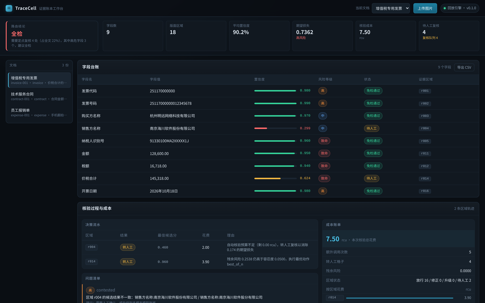
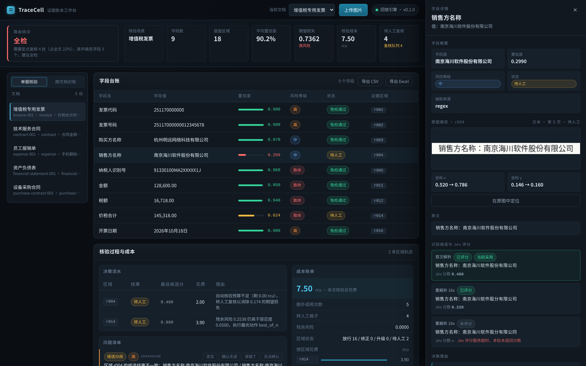
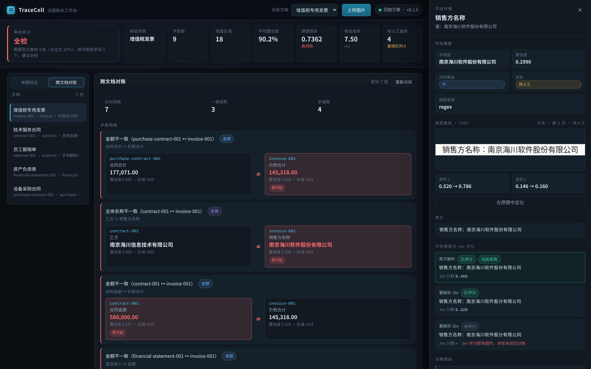

# TraceCell

> Other tools hand you OCR output. TraceCell hands you a conclusion you can sign off on.

`Apache-2.0` · `Python 3.10+` · `MCP` · `MiniCPM-OCR 1.0` / `MiniCPM-OCR Jev` / `MiniCPM-V 4.7`

Repository: [GitHub](https://github.com/logicore-code/TraceCell) · [GitCode](https://gitcode.com/gcw_EkTYFH3T/TraceCell) · [中文](README.md)



## The problem

Document recognition has improved a lot. MiniCPM-OCR 1.0 is already state of the
art on real-world captures. But what enterprises actually pay for is not the
misread — it is the misread nobody noticed.

One digit wrong in an invoice amount, and nothing marks it. The number flows
into the ledger, into the report, into reconciliation. Six months later someone
finds the discrepancy and has to trace it back. The expensive failure is never
the wrong reading; it is the wrong reading that nobody flagged.

MiniCPM-OCR Jev, released by OpenBMB in October 2026, adds a 0–1 correctness
score per region. That closes the gap between "how good is this reading" and
"can this document be used" — but only partly. Someone still has to decide what
a score of 0.62 means, which fields are worth re-checking, when a second
reading is worth the compute, and what happens when two documents disagree.

TraceCell is that layer.

## Demo

A 40-second walkthrough is in `docs/demo.mp4` (recorded by
`scripts/record_demo.py`):


## What it produces

Given a document, TraceCell produces an **evidence ledger** rather than a
Markdown blob. Every field carries the region it came from, a confidence, and a
status:

| | Question it answers |
| --- | --- |
| Coordinates | Which part of the original page is this value from? |
| Confidence | How much should I trust it? |
| Status | Does a human still need to look at it? |

On top of that it gives a document-level verdict — auto-pass, spot-check, or
full review — plus a review checklist your team can work through directly.



Click any field and you get the cropped region from the original image, its
coordinates, every candidate reading, the Jev score for each, and the reason
the agent reached its conclusion.

## One engine, five document families

Invoice verification, financial statement verification, purchase/sales contract
amount verification — these look like different problems, but they decompose
the same way: read the fields, judge how much each one can be trusted, find
the places that contradict each other, decide what a human should look at.

So the engine is written once, and the differences between document types live
in a single configuration file:

| Scenario | Declared fields | Internal checks | Compared against |
| --- | --- | --- | --- |
| `invoice` | 9 | total = amount + tax | purchase contracts, service contracts, statements |
| `contract` | 8 | uppercase amount = lowercase amount | invoices (party, amount) |
| `expense` | 6 | line items sum = total | — |
| `financial_statement` | 10 | assets = current + non-current; assets = liabilities + equity | invoices (revenue) |
| `purchase_contract` | 13 | per line: amount = qty × price; total = sum of lines; uppercase = lowercase | invoices (total, buyer, seller) |

"Declared fields" is what the scenario config lists. Line items are extracted
at runtime from table rows, so the ledger holds more: three extra for the
expense report, nine for the purchase contract.

Adding a document type means adding a configuration block. The engine does not
change.

```bash
tracecell scenarios      # list supported scenarios and their consistency rules
```

### Cross-document reconciliation

A contract says `合同总价`; an invoice says `价税合计`. A contract says `乙方`;
an invoice says `销售方名称`. Reconciling by matching field names never works —
so TraceCell pairs them explicitly, per scenario.

The same-name trap is fixed too: the invoice's `金额` and the expense
report's `金额` are never compared against each other.



## How it works

### Confidence is inherited pessimistically

A field's confidence is the **minimum** across the regions that support it.
A contract total assembled from two regions is wrong if either one was wrong.
Averaging would hide the error, and hiding the error is the one thing this
project exists to prevent.

When two candidates disagree, the confidence is discounted by 0.65 — the
disagreement itself is evidence of uncertainty.

### Verification closes the loop

Jev can tell you a region is probably wrong. It cannot tell you what is
actually written there. The system has to close that loop itself:

```
   first parse (4x)  →  Jev 0.31  →  re-parse at 16x  →  Jev picks 0.88  →  pass
                                              ↓
                                    still unsure → MiniCPM-V 4.7 review
                                              ↓
                                       still unsure → human review
```

The adversarial candidate comes from re-reading the same region at a different
visual compression setting (`4x` vs `16x`). Two readings that disagree are
exactly the signal that the region is ambiguous.

The escalation question is deliberately narrow — *"is this 145,318.00 or
145,818.00?"* — because a narrow answer is short, checkable, and can be fed
back into the loop as a new candidate. A broad one produces prose that nothing
can verify.

### Each cell gets a budget

Every region is asked the same question: how much residual risk am I
accepting, what would another pass buy me, and what does a human cost?

Actions are compared on risk reduction per unit of compute. Human review
competes in the same table (accuracy 0.995, cost 8 units) — on a low-stakes
field, sending it to a human is waste; on a high-stakes one it can beat three
more model calls. The budget is allocated by risk tier.

### Reconciliation catches what better models cannot

Two documents can both be read perfectly and still contradict each other. A
detail line that does not add up to the total. A contract total that does not
match the invoice. A balance sheet that does not balance. No amount of OCR
accuracy fixes these — only cross-field arithmetic does.

## Numbers that come from a real model

Two artefacts in the repository are recordings, not hand-written numbers:

- `samples/real_ocr/` — what MiniCPM-OCR 1.0 actually reads on the sample
  documents, produced by llama.cpp on CPU (`scripts/record_ocr.py`).
- `samples/jev_scores.json` — what Jev actually scores every candidate,
  also llama.cpp with the official GGUF weights (`scripts/record_jev.py`).

The sample sessions read their confidence values back from that recording, so
the thresholds and the AUROC quoted below sit on top of a real model rather
than on plausible-looking constants.

`references/jev_official/` holds the three example cases from the Jev repository
(Apache-2.0), each with the reference render and the probability the official
implementation produced. `scripts/verify_against_official.py` checks this
setup against them: scoring the official render reproduces the official
probability to within 0.005 on all three.

One caveat the official examples spell out: absolute Jev scores are not
probabilities of correctness — the correct transcription of a table scores
0.04. Compare candidates against each other, never against a fixed threshold.
That is why the threshold here is calibrated rather than assumed.

## What it saves

Every document verification scheme answers the same two questions: how much
human effort, and how many errors slip through. `tracecell baseline` runs
three strategies over the same sample set:

```
$ tracecell baseline --session samples/sessions

Strategy            Human review    Share    Missed: OCR    Missed: document    Cost
------------------------------------------------------------------------------------
All by hand               83      100.0%             0                 0      0.00 rcu
Trust the OCR              0        0.0%             2                 8      0.00 rcu
TraceCell                 16       19.3%             0                 0     54.00 rcu

83 regions in total: 2 reading errors, 8 document-level contradictions.
```

The two error classes do not overlap: a reading error is measured against what
is printed on the page, so a document that is wrong on paper is a contradiction,
not a misreading.

The second row is the interesting one. "Trust the OCR" misses 8 contradictions
that OCR read *perfectly*. A better model does not help; only cross-field
arithmetic does.

The third row is not "check less". It is 83 regions narrowed to 16 by risk,
where those 16 are the ones with contested readings, failing arithmetic, or
critical fields. The other 67 are confirmed clean, not unchecked.

The sample set includes one case that makes the point: an invoice sells the
company as `南京海川软件**股份**有限公司`, and the OCR reads it confidently
(0.91) as `南京海川软件**股分**有限公司`. Trust the OCR and the wrong legal
entity goes into the ledger. TraceCell flags it for review — and the
cross-document check independently finds the same discrepancy from the contract
side. Two unrelated chains point at the same error.

## Production surface

- **Input**: images and PDF. PDF pages are rendered with pypdfium2 (PDFium,
  BSD-3 — deliberately not PyMuPDF, which is AGPL-3.0). Multi-page documents
  keep track of which page each region came from.
- **Batch**: `tracecell batch invoices/ --out ledgers/ --jobs 8`. One bad file
  does not stop the batch. Failures are reported, not swallowed.
- **Export**: CSV ledger, Markdown review report, JSON, and an Excel workbook
  with four sheets (fields, findings, review checklist, candidate detail).
- **Degradation**: each model is wrapped. If scoring is down, affected regions
  go to human review — never silently pass. If escalation is down, the region
  goes to a human instead of retrying until the budget is gone.
- **Human review loop**: reviewers mark regions correct / wrong / unreadable.
  Confirmations release the region; corrections become new candidates. The
  annotation itself becomes a calibration sample, so the effort spent
  reviewing becomes the data used to calibrate thresholds next time.
- **Audit trail**: parse, score, decide, act — timestamped and exportable.
- **MCP server**: 9 tools, so any MCP-capable agent can call it.

### Threshold and coefficients are not hardcoded

```bash
tracecell fit-gains samples/sessions/*.json --out policy.json
tracecell parse invoice.png --calibrate samples/labelled.json
tracecell parse invoice.png --policy policy.json
```

`fit-gains` regresses "how often does a different strategy actually fix a
region" from recorded sessions. It stays conservative when the sample is thin.

### Layout detection

The bundled projection-based detector needs no model. For real scans, switch
to the official PP-DocLayoutV3:

```bash
pip install onnxruntime
python3 scripts/fetch_layout_model.py
export TRACECELL_LAYOUT_MODEL=$(python3 scripts/fetch_layout_model.py --path-only)
```

ONNX build (~136MB), runs on onnxruntime, no PyTorch or PaddlePaddle needed.
On the sample invoice the official detector finds 27 regions against the
bundled detector's 20, with cleaner table boundaries.

## Quick start

```bash
git clone https://github.com/logicore-code/TraceCell.git
cd TraceCell
pip install -e ".[web]"

tracecell demo      # run the full pipeline over the bundled samples
tracecell serve     # workbench on http://127.0.0.1:8000
```

The bundled samples are **synthetic** — generated by
`scripts/make_samples.py`, not real invoices. They contain deliberate
difficulty: low-contrast small print, a captured-photo rotation, disagreeing
readings, a transposed digit, and a balance sheet that does not balance.

## Project layout

```
src/tracecell/
├── scenarios.py      scenario configs: fields, risk, consistency, pairing  ← add a scenario here
├── chinese_amount.py Chinese uppercase amount parsing
├── pages.py          image / PDF input
├── batch.py          batch verification
├── feedback.py       human review write-back
├── degrade.py        model degradation and retries
├── audit.py          audit trail
├── export.py         CSV / Markdown / JSON / Excel
├── baseline.py       strategy comparison
├── types.py          data contracts
├── policy.py         cost model, budget policy
├── risk.py           confidence inheritance, expected loss
├── budget.py         per-cell budget decisions  ← core
├── routing.py        document-level routing, sampling
├── calibration.py    AUROC, isotonic regression, threshold search
├── reconcile.py      consistency checks, cross-document reconciliation  ← core
├── ledger.py         ledger assembly and export
├── extractors.py     field extraction
├── agent/loop.py     verification loop  ← core
├── providers/        clients for the three models, plus replay
├── mcp/server.py     MCP server (hand-written stdio JSON-RPC)
└── web/app.py        web application
```

## Known boundaries

- The bundled layout detector is projection-based and works at text-line
  granularity, so complex tables and multi-column layouts drift. `detect` is an
  interface — the official PP-DocLayoutV3 (ONNX) drops straight in.
- Consistency relations are declared per scenario: sum, product, amount-forms,
  rows-product, rows-sum. Relations with division are not included — the
  tolerance is hard to pick and false positives are worse than misses.
- Line-item tables are extracted per row; a table split across pages is not
  stitched back together.
- Reconciliation compares field values. It does not understand clause semantics:
  two contracts with identical amounts can still be legally incompatible.
  TraceCell catches transcription errors, not bad drafting.
- A whole-paragraph hallucination in a contract body is only partly caught by
  the region-level loop; solving it properly needs a semantic consistency layer.
- Confidence is a ranking score, not a probability: 0.9 does not mean 90%
  correct. The repository ships isotonic regression for calibration, but it
  needs your own labelled data to be useful.
- Jev cannot judge seals and graphics — on the samples those regions score
  0.11~0.58 even though their text is correct. Rules and human review cover
  those, not the model.

## License

Code and documentation are under [Apache-2.0](LICENSE). TraceCell uses but does
not bundle OpenBMB model weights; the models follow their own licenses
(MiniCPM-OCR 1.0 and Jev are Apache-2.0).
